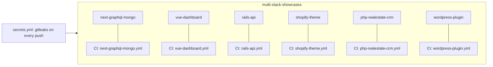

# multi-stack-showcases

Small, tested reference apps by DCtech., one folder per stack. Each folder is self-contained: its own README, one command to run it, fictional data only, and its own CI workflow that runs only when that folder changes.

| Folder | Stack | What it shows | CI |
|---|---|---|---|
| [`next-graphql-mongo/`](next-graphql-mongo) | Next.js 16 (App Router), GraphQL Yoga, MongoDB | Project tracker: Server Component page + GraphQL API, tested against a real MongoDB, Docker compose smoke test |  |
| [`vue-dashboard/`](vue-dashboard) | Vue 3, TypeScript, Vite | Inventory dashboard over mock data shaped like the warehouse API's OpenAPI spec, component tests |  |
| [`rails-api/`](rails-api) | Ruby on Rails 8.1 (API mode), RSpec | Lending-library JSON API with validations, request specs, Docker compose smoke test |  |
| [`shopify-theme/`](shopify-theme) | Shopify Liquid (Online Store 2.0) | Minimal theme validated with Theme Check, no real store |  |
| [`php-realestate-crm/`](php-realestate-crm) | PHP 8, MySQL | Property listings + lead/visit CRM API, PHPUnit and PHPStan |  |
| [`wordpress-plugin/`](wordpress-plugin) | WordPress, PHP | Lead-capture shortcode plugin tested in the WordPress test suite, PHPCS |  |

## How it is organised

- **One workflow per folder**, filtered with `paths:` so a change in one stack never runs another stack's tests.
- **Secret scanning** (gitleaks, full history) runs on every push and pull request from `secrets.yml`.
- **Dependabot** watches each folder's package manager and the GitHub Actions versions.
- **Fictional data only.** No real customers, stores, credentials or personal data anywhere.

These are deliberately small. They show that the stack is understood and tested, not a full product. The larger product-style reference is [warehouse-inventory-platform](https://github.com/dc-tech-inc/warehouse-inventory-platform).

## Em português

Monorepo de exemplos pequenos e testados, uma pasta por stack, cada uma com README, um comando para rodar, dados fictícios e CI próprio.

## License

[MIT](LICENSE) © 2026 DC TECH INC
