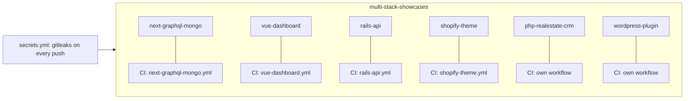

# multi-stack-showcases

Small, tested reference apps by **DC TECH INC**, one folder per stack. Each folder is self-contained: its own README, one command to run it, fictional data only, and its own CI workflow that runs only when that folder changes.

| Folder | Stack | What it shows | Status |
|---|---|---|---|
| [`next-graphql-mongo/`](next-graphql-mongo) | Next.js (App Router), GraphQL, MongoDB | Typed GraphQL schema + resolvers over MongoDB, server-rendered page | in progress |
| [`vue-dashboard/`](vue-dashboard) | Vue 3, TypeScript, Vite | Inventory dashboard over mock data shaped like the warehouse API's OpenAPI spec | in progress |
| [`rails-api/`](rails-api) | Ruby on Rails (API mode), RSpec | JSON API with validations and request specs | in progress |
| [`shopify-theme/`](shopify-theme) | Shopify Liquid | Minimal Online Store 2.0 theme validated with `theme-check` (no real store) | in progress |
| `php-realestate-crm/` | PHP 8, MySQL | Property catalog + small CRM with fictional data | in progress |
| `wordpress-plugin/` | WordPress, PHP | Minimal plugin with PHPUnit in CI | in progress |

## How it is organised

- **One workflow per folder**, filtered with `paths:` so a change in one stack never runs another stack's tests.
- **Secret scanning** (gitleaks, full history) runs on every push and pull request from `secrets.yml`.
- **Dependabot** watches each folder's package manager and the GitHub Actions versions.
- **Fictional data only.** No real customers, stores, credentials or personal data anywhere.

These are deliberately small. They show that the stack is understood and tested, not a full product. The larger product-style reference is [warehouse-inventory-platform](https://github.com/dc-tech-inc/warehouse-inventory-platform).

## Em português

Monorepo de exemplos pequenos e testados, uma pasta por stack, cada uma com README, um comando para rodar, dados fictícios e CI próprio.

## License

[MIT](LICENSE) © 2026 DC TECH INC
