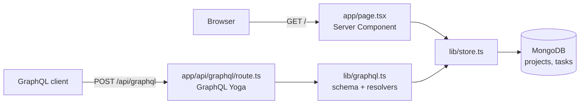

# next-graphql-mongo

[](https://github.com/dc-tech-inc/multi-stack-showcases/actions/workflows/next-graphql-mongo.yml)

A small project tracker on **Next.js 16 (App Router)**, **GraphQL** (GraphQL Yoga in a route handler) and **MongoDB** (official Node.js driver). The home page is a Server Component that reads MongoDB directly; the same data is exposed as a GraphQL API at `/api/graphql` with queries for projects and tasks and mutations to add tasks and change their status. Data is fictional.



## Run

```bash
docker compose up --build    # http://localhost:3000, GraphiQL is off in production builds
```

Without Docker: copy `.env.example` to `.env.local`, point `MONGODB_URI` at a MongoDB 8 instance, then `npm ci && npm run dev` (GraphiQL at http://localhost:3000/api/graphql).

```graphql
query {
  projects { id name doneCount taskCount tasks(status: TODO) { title } }
}
mutation {
  addTask(projectId: "<id>", title: "Write release notes") { id status }
}
```

Scripts: `npm run lint`, `npm run typecheck`, `npm test`, `npm run test:coverage`, `npm run build`.

## What is tested

16 tests run against a real MongoDB: a `mongo:9` service container in CI, or an in-memory `mongod` ([mongodb-memory-server](https://github.com/typegoose/mongodb-memory-server)) locally when `MONGODB_URI` is unset. Each test file uses its own throwaway database.

- `store.test.ts`: aggregation counts, sorting, seeding only an empty database, title trimming and length limits, malformed ids rejected as `BAD_USER_INPUT`, unknown records as `NOT_FOUND`.
- `graphql.test.ts`: the full HTTP path through Yoga (`yoga.fetch`): queries, nested filtered tasks, mutations, error codes, schema validation of enum values, and masking of unexpected errors (no internal message leaks).
- `db.test.ts`: clear error when `MONGODB_URI` is missing, retry after a failed start, one shared client, demo seed.

CI also runs `docker compose up` and checks the page and the GraphQL endpoint return the seeded data.

## Decisions

- **Yoga in a route handler** rather than a separate server: one deployable, and Yoga speaks the Fetch API that App Router handlers use, so tests call `yoga.fetch` with no HTTP server.
- **Counts come from one `$lookup` aggregation**, so listing projects does not issue a query per project. `Project.tasks` is still one query per project when requested; a DataLoader is the next step if lists grow.
- **Store functions throw `GraphQLError` with a `code`.** Yoga passes those to the client and masks everything else as `Unexpected error.`
- **graphql 16** (not 17): GraphQL Yoga 5 and graphql-tools are built and tested against 16. The Vitest config aliases `graphql` to its CommonJS entry so tests load a single copy (Node loads Yoga's dependency through CommonJS).

## Limitations

No authentication, no pagination on tasks, no client-side interactivity (the page is read-only; changes go through GraphQL). Not deployed.

## References

- Next.js: [Route Handlers](https://nextjs.org/docs/app/getting-started/route-handlers), [Server Components and data fetching](https://nextjs.org/docs/app/getting-started/fetching-data), [`output: "standalone"`](https://nextjs.org/docs/app/api-reference/config/next-config-js/output), [ESLint config](https://nextjs.org/docs/app/api-reference/config/eslint)
- GraphQL Yoga: [Integration with Next.js](https://the-guild.dev/graphql/yoga-server/docs/integrations/integration-with-nextjs), [Error masking](https://the-guild.dev/graphql/yoga-server/docs/features/error-masking), [Testing](https://the-guild.dev/graphql/yoga-server/docs/features/testing)
- MongoDB Node.js driver: [Connection guide](https://www.mongodb.com/docs/drivers/node/current/connect/), [Aggregation `$lookup`](https://www.mongodb.com/docs/manual/reference/operator/aggregation/lookup/)
- [GraphQL specification](https://spec.graphql.org/) · [Vitest globalSetup and `provide`/`inject`](https://vitest.dev/config/#globalsetup)
