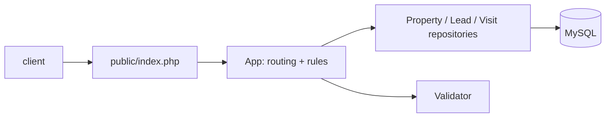

# php-realestate-crm

A small real-estate **listings + lead/visit CRM** JSON API in plain PHP 8 and MySQL. It is a clean-room recreation of the concept with **fictional data** (invented names, `example.com` e-mails, `555-01xx` phones); it contains nothing from any client site.

**What it demonstrates:** PDO prepared statements, schema design with foreign keys and a unique constraint, a transactional business rule, input validation, and a framework-free router that is unit/integration tested and statically analysed (PHPStan level 8).

## Run it (one command)

```bash
cp .env.example .env && docker compose up --build
curl "http://localhost:8080/properties?city=Lakeside&status=available"
```

The MySQL container loads `db/schema.sql` and `db/seed.sql` on first start.

## API

| Method | Path | Notes |
|---|---|---|
| GET | `/health` | liveness |
| GET | `/properties` | filters: `city`, `status`, `max_price`, `min_bedrooms` |
| GET | `/properties/{id}` | 404 when unknown |
| GET / POST | `/leads` | `GET ?stage=`; POST validates name, e-mail, phone, `property_id` |
| PATCH | `/leads/{id}` | body `{"stage": "contacted"}` |
| GET / POST | `/visits` | POST `{lead_id, property_id, scheduled_at}`; 409 on a double booking or a non-available property; moves a `new`/`contacted` lead to `visit_scheduled` in the same transaction |



## Develop and test

```bash
composer install
composer analyse                      # PHPStan, level 8
composer test                         # unit tests; integration tests need a MySQL
DB_HOST=127.0.0.1 DB_NAME=realestate DB_USER=realestate DB_PASSWORD=... composer test
```

CI (`.github/workflows/php-realestate-crm.yml`) runs PHPStan and the full PHPUnit suite against a MySQL 8.4 service container.

## Limitations

- No authentication, pagination or rate limiting: it is a reference, not a deployable product.
- `price_usd` is a whole-dollar integer; there is no currency model.
- Visits cannot be cancelled or rescheduled yet; the unique slot is per property and exact timestamp.
- `composer.lock` is not committed yet (dependencies resolve at install time).

## Official docs

[PHP PDO](https://www.php.net/manual/en/book.pdo.php) · [MySQL 8.4 reference](https://dev.mysql.com/doc/refman/8.4/en/) · [PHPUnit](https://docs.phpunit.de/en/11.5/) · [PHPStan](https://phpstan.org/user-guide/getting-started) · [Docker Compose](https://docs.docker.com/compose/)
