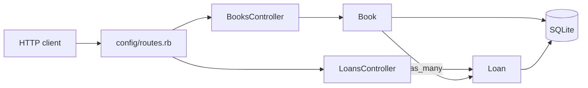

# rails-api

[](https://github.com/dc-tech-inc/multi-stack-showcases/actions/workflows/rails-api.yml)

A small lending-library JSON API on Ruby on Rails 8.1 (API-only mode) with RSpec. Books have copies; a loan takes a copy until it is returned; overdue loans can be listed. Data is fictional and stored in SQLite, so it runs with no other services.



## Run

```bash
docker compose up --build     # http://localhost:3000/books (migrates and seeds on start)
```

With Ruby 4.0 installed: `bundle install && bin/rails db:prepare db:seed && bin/rails server`. Tests: `bundle exec rspec` (add `COVERAGE=1` for SimpleCov), style: `bundle exec rubocop`. On Windows, run `bundle lock --add-platform x64-mingw-ucrt` first, or use Docker.

| Method | Path | Notes |
|---|---|---|
| GET | `/books?q=&limit=&offset=` | Search title/author; `{ items, total }`; each book has `available_copies` |
| GET / POST / PATCH / DELETE | `/books`, `/books/:id` | Body `{ "book": { title, author, isbn, copies } }`; delete is refused (409) once a book has loans |
| POST | `/books/:book_id/loans` | `{ "loan": { borrower_name, due_on? } }`; due date defaults to 14 days |
| PATCH | `/loans/:id/return` | 409 if already returned |
| GET | `/loans?status=active\|overdue\|returned\|all` | Default `active`, ordered by due date |
| GET | `/up` | Health check |

Errors always look like `{ "error": { "status": 422, "message": "Validation failed", "details": { "isbn": ["has an invalid check digit"] } } }`.

## Rules covered by tests

- ISBN-13 is normalised (dashes removed), must start with 978/979 and have a valid **check digit**; unique.
- A loan is refused when no copy is available; `copies` cannot be lowered below the copies on loan.
- Due dates must be between today and 60 days out. Overdue = unreturned after the due date (tested with `travel_to`).
- Search escapes `%` and `_` (`sanitize_sql_like`). Bad paging values fall back to defaults instead of erroring.
- Listing books computes availability with one correlated subquery, not one `COUNT` per book.

Specs: `spec/models` (Book, Loan) and `spec/requests` (every endpoint, status codes, error shape). CI runs RuboCop, RSpec with SimpleCov branch coverage, checks that `Gemfile.lock` and `db/schema.rb` are committed and current, and boots the Docker image to query the seeded API.

## Decisions

- **SQLite**: zero setup for a demo. Lending the last copy happens inside `book.with_lock`, which becomes `SELECT … FOR UPDATE` on PostgreSQL; on SQLite, writes are already serialised.
- **No serializer gem**: `as_json` on two models is enough at this size.
- **Ruby is not installed on the authoring machine**, so CI is where this app is first run. `Gemfile.lock` and `db/schema.rb` came from the first CI run (uploaded as an artifact) and were committed afterwards; CI now fails if they drift.

## Limitations

No authentication or borrower accounts (a borrower is a name), no rate limiting, development-mode Docker image only. Not deployed.

## References

- Rails guides: [Using Rails for API-only applications](https://guides.rubyonrails.org/api_app.html), [Active Record validations](https://guides.rubyonrails.org/active_record_validations.html), [Active Record migrations](https://guides.rubyonrails.org/active_record_migrations.html), [Routing (member routes)](https://guides.rubyonrails.org/routing.html#adding-member-routes), [Strong parameters `params.expect`](https://api.rubyonrails.org/classes/ActionController/Parameters.html#method-i-expect), [Testing time helpers](https://api.rubyonrails.org/classes/ActiveSupport/Testing/TimeHelpers.html)
- [RSpec Rails request specs](https://rspec.info/features/8-0/rspec-rails/request-specs/request-spec/) · [SimpleCov](https://github.com/simplecov-ruby/simplecov) · [rubocop-rails-omakase](https://github.com/rails/rubocop-rails-omakase)
- [ISBN-13 check digit](https://www.isbn-international.org/content/isbn-users-manual/29) (ISBN Users' Manual)
