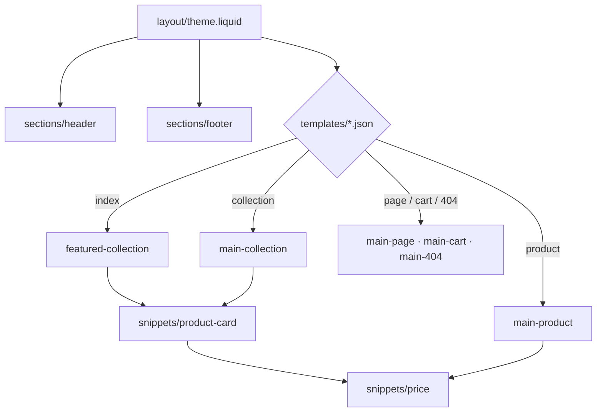

# shopify-theme

[](https://github.com/dc-tech-inc/multi-stack-showcases/actions/workflows/shopify-theme.yml)

A minimal Shopify Online Store 2.0 theme in Liquid: JSON templates, sections with settings schemas, reusable snippets, translated strings and theme settings. It is validated in CI with Theme Check (Shopify's linter) at the strictest fail level. There is no real store behind it; nothing is published.



## Run

```bash
npm ci && npm run check      # Theme Check, fails on any offense (suggestion level and above)
```

To preview it you need your own development store: `npm run dev -- --store <your-store>.myshopify.com` (Shopify CLI asks you to log in). The repository never stores credentials or a store name.

## What it covers

- **Templates as JSON** (`templates/*.json`) that compose sections, so merchants can rearrange them in the theme editor.
- **Sections with schemas**: header (menu `link_list`), footer (`richtext`), featured collection (`collection` + `range` setting, placeholder products when none is chosen, editor preset), product (variant `select`, quantity, add to cart / sold out via the `product` form), collection grid with `paginate`, cart with quantity updates, page and 404.
- **Snippets** rendered with `` (isolated scope): `price` (sale price with the compare-at price struck through and screen-reader labels) and `product-card`.
- **Responsive images** with `image_url` + `image_tag` (`widths`, `sizes`, lazy loading below the fold).
- **Translations**: every visible string goes through `t` (`locales/en.default.json`), every editor label through `t:` keys (`locales/en.default.schema.json`).
- **Theme settings** (`config/settings_schema.json`): accent colour and page width, exposed as CSS custom properties.

CI also proves the check is a real gate: a broken filter or a missing snippet makes it exit non-zero (`MissingTemplate`, `UnknownFilter` errors).

## Limitations

Shopify coverage here is **lint-level only**: Liquid only renders inside Shopify, so there are no rendering tests, no store, no apps, no checkout customisation. Templates for search, blogs, customer accounts and gift cards are not included.

## References

- [Theme architecture](https://shopify.dev/docs/storefronts/themes/architecture) · [Templates (JSON)](https://shopify.dev/docs/storefronts/themes/architecture/templates/json-templates) · [Sections and section schema](https://shopify.dev/docs/storefronts/themes/architecture/sections/section-schema) · [Settings input types](https://shopify.dev/docs/storefronts/themes/architecture/settings/input-settings)
- [Theme Check](https://shopify.dev/docs/storefronts/themes/tools/theme-check) · [Shopify CLI `theme check`](https://shopify.dev/docs/api/shopify-cli/theme/theme-check)
- [Liquid reference](https://shopify.dev/docs/api/liquid): [`render`](https://shopify.dev/docs/api/liquid/tags/render), [`paginate`](https://shopify.dev/docs/api/liquid/tags/paginate), [`image_tag`](https://shopify.dev/docs/api/liquid/filters/image_tag), [`form`](https://shopify.dev/docs/api/liquid/tags/form)
- [Locale files](https://shopify.dev/docs/storefronts/themes/architecture/locales)
