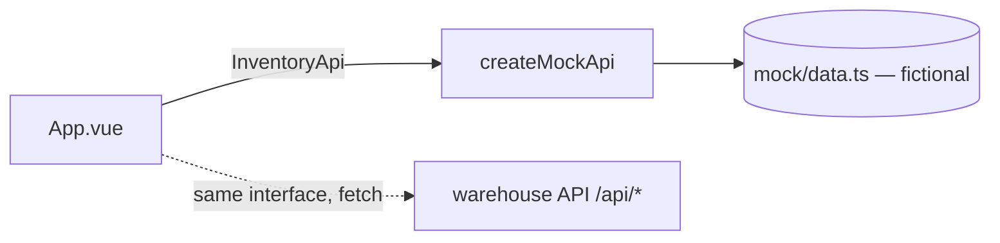

# vue-dashboard

[](https://github.com/dc-tech-inc/multi-stack-showcases/actions/workflows/vue-dashboard.yml)

Inventory dashboard in **Vue 3 + TypeScript** (Composition API, `<script setup>`, Vite). It reads headline counts, warehouses and a paged, searchable product list. The data is fictional and served by an in-memory mock that follows the OpenAPI 3.1 contract of [warehouse-inventory-platform](https://github.com/dc-tech-inc/warehouse-inventory-platform): the `Dashboard`, `Warehouse`, `Product` and `ProductListResponse` schemas, and the `GET /api/products` paging rules (`limit` 1–100, default 25, `offset` ≥ 0).



## Run

```bash
npm ci && npm run dev        # http://localhost:5173
```

No configuration needed. Other scripts: `npm run lint`, `npm run typecheck` (vue-tsc), `npm test`, `npm run test:coverage`, `npm run build`.

## What is tested

- `test/api.test.ts`: the mock honours the API contract (sorting, default page size, limit/offset, case-insensitive search on SKU and name, low-stock filter that never includes inactive products, out-of-range paging rejected, dashboard counts consistent with products).
- `test/App.test.ts` (Vue Test Utils + jsdom): headline cards, paging forward and back with disabled buttons at the ends, search resets to the first page, low-stock highlighting, empty state, API error shown in an `role="alert"` element.

## Decisions

- **The component depends on an `InventoryApi` interface, passed as a prop.** Tests inject a failing API without module mocking, and connecting the real backend means writing a `fetch` implementation of the same three methods (the warehouse API uses a session cookie, so that client would also handle login).
- **Types are hand-copied from the OpenAPI document** rather than generated, to keep this folder dependency-light. A generator such as `openapi-typescript` is the next step if the contract starts changing often.
- **TypeScript 6.0** is pinned because `vue-tsc` builds on the TypeScript compiler API.

## Limitations

Mock data only, no authentication, no charts. Not deployed.

## References

- Vue: [Composition API FAQ](https://vuejs.org/guide/extras/composition-api-faq.html), [`<script setup>`](https://vuejs.org/api/sfc-script-setup.html), [TypeScript with the Composition API](https://vuejs.org/guide/typescript/composition-api.html)
- [Vite guide](https://vite.dev/guide/) · [Vitest guide](https://vitest.dev/guide/) · [Vue Test Utils: asynchronous behaviour](https://test-utils.vuejs.org/guide/advanced/async-suspense.html)
- [eslint-plugin-vue user guide](https://eslint.vuejs.org/user-guide/)
