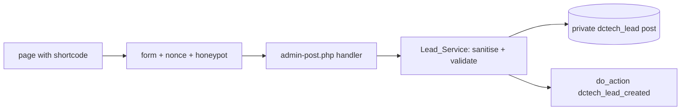

# wordpress-plugin: DC Tech Property Leads

A minimal WordPress plugin that adds a **lead-capture form shortcode** for property listings. Leads are stored as private posts of an admin-only post type, and a `dctech_lead_created` action lets a site forward them to a CRM (for example the sibling [`php-realestate-crm`](../php-realestate-crm)). It is an original example with no client code.

**What it demonstrates:** the WordPress plugin lifecycle, shortcodes, `admin-post.php` form handling with nonce + honeypot, input sanitisation and output escaping, a custom post type, and tests that run inside the **real WordPress test suite** with PHPCS (WordPress Coding Standards) in CI.

## Use it

```text
[dctech_lead_form property="Loft 9"]
```

Copy the folder to `wp-content/plugins/`, activate it, and put the shortcode in a page. Leads appear under **Leads** in the admin menu.

## Run it locally (one command)

```bash
npx @wordpress/env start   # needs Docker; mounts this plugin into a throwaway WordPress
```

`.wp-env.json` is a convenience for manual poking; CI does not use it.

## Develop and test

```bash
composer install
composer lint                                   # PHPCS, WordPress standard
cp .env.example .env                            # throwaway DB only: the suite drops its tables
# download WordPress 6.8.2 into WP_CORE_DIR, export the variables from .env, then:
composer test
```

CI (`.github/workflows/wordpress-plugin.yml`) downloads WordPress core (sha1-verified), starts MySQL 8.0 as a service container and runs PHPCS and the PHPUnit suite via [`wp-phpunit`](https://packagist.org/packages/wp-phpunit/wp-phpunit).



## Limitations

- Pages that embed the form must not be fully page-cached, or the nonce can expire (the usual nonce trade-off).
- No rate limiting or CAPTCHA beyond the honeypot; no e-mail notification yet.
- Tested against WordPress 6.8.2 on PHP 8.3 only; `composer.lock` is not committed yet.
- Not packaged for the wordpress.org directory (no `readme.txt`, no translations files).

## Official docs

[Plugin handbook](https://developer.wordpress.org/plugins/) · [Shortcode API](https://developer.wordpress.org/apis/shortcode/) · [Data validation](https://developer.wordpress.org/apis/security/data-validation/) · [Escaping](https://developer.wordpress.org/apis/security/escaping/) · [Nonces](https://developer.wordpress.org/apis/security/nonces/) · [Automated testing](https://make.wordpress.org/core/handbook/testing/automated-testing/phpunit/) · [WordPress Coding Standards](https://github.com/WordPress/WordPress-Coding-Standards)
